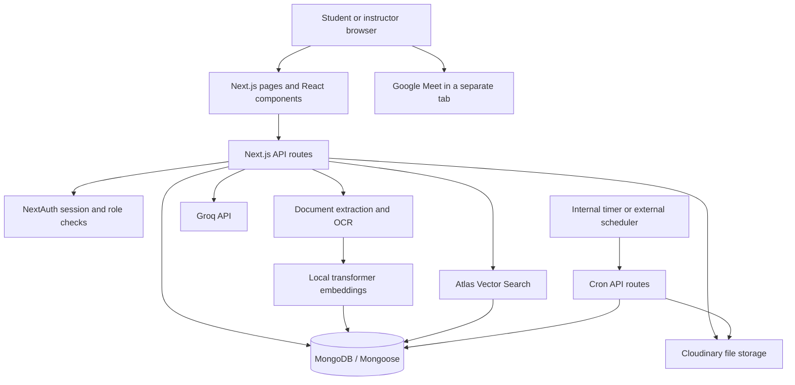

# EduHelp LMS

A learning management system for instructors and students, built with Next.js, React, and MongoDB. EduHelp brings exams, assignments, learning materials, document assistance, messaging, and Google Meet classes into one workspace.

[Live application](https://edu-help-iota.vercel.app) | [Design guide](DESIGN.md) | [Testing guide](TESTING.md)

## Table of contents

- [Overview](#overview)
- [Features](#features)
- [Architecture](#architecture)
- [Technology stack](#technology-stack)
- [Project structure](#project-structure)
- [Getting started](#getting-started)
- [Environment configuration](#environment-configuration)
- [Atlas Vector Search setup](#atlas-vector-search-setup)
- [User manual](#user-manual)
  - [Accounts and navigation](#accounts-and-navigation)
  - [Instructor guide](#instructor-guide)
  - [Student guide](#student-guide)
  - [Online classes with Google Meet](#online-classes-with-google-meet)
- [Development and testing](#development-and-testing)
- [Deployment](#deployment)
- [Scheduled jobs and data lifecycle](#scheduled-jobs-and-data-lifecycle)
- [Troubleshooting](#troubleshooting)
- [Documentation and references](#documentation-and-references)

## Overview

EduHelp provides two role-based dashboards:

| Role | Main tasks |
| --- | --- |
| Instructor | Create exams, review results, publish announcements and materials, grade assignments, schedule classes, and message students. |
| Student | Take assigned exams, review attempts, submit assignments, browse materials, use document assistance, join classes, and message instructors. |

Start with [Getting started](#getting-started) to run the project, or jump to the [User manual](#user-manual) to use an existing deployment.

## Features

| Area | Capabilities |
| --- | --- |
| Exams | Practice and scheduled tests, AI-assisted question extraction from uploaded documents, server-side scoring, attempt review, and instructor analytics. |
| Exam safeguards | Fullscreen prompts, tab/window monitoring, strike tracking, copy/paste restrictions, and time tracking. These browser controls do not guarantee prevention of cheating. |
| Offline exam recovery | Locally cached answers and a pending-submission retry when connectivity returns. See [testing boundaries](TESTING.md#honest-coverage-boundaries) for recovery scenarios that still need isolated integration testing. |
| Assignments | Cohort targeting, deadlines, file submissions, grades, and instructor feedback. |
| Materials | Course folders, document and video uploads, embedded video playback, and semantic search. |
| Document assistance | Text extraction, OCR fallback for images/scanned PDFs, vector retrieval, and a Groq-backed conversational assistant. Generated answers should be checked against the source material. |
| Announcements | Department/batch targeting and optional attachments. |
| Classes | Instructor-provided Google Meet links, scheduled/live/completed states, and audience checks before students receive a live link. |
| Communication | Direct messages, unread counts, and in-app notifications. |
| Interface | Responsive cyan glassmorphism, light/dark/system themes, persistent preferences, and keyboard focus styles. |
| Data management | Paginated content lists, retention indexes, and cleanup endpoints for expired records and related assets. |

## Architecture

EduHelp is a single Next.js application. The App Router serves the interface and API routes; server-side handlers access MongoDB and external integrations.



### Main application flows

1. **Authentication:** NextAuth supplies the session. Protected API handlers check the session and role; resource-specific handlers also check ownership or audience restrictions.
2. **Exams and coursework:** Dashboards call API routes to read or update exams, attempts, assignments, submissions, announcements, and materials through Mongoose models.
3. **Document assistance:** Uploaded documents are parsed into chunks. The local embedding model generates 384-dimensional vectors, Atlas retrieves relevant chunks, and the Groq API generates an answer using the retrieved context. First use may download model files and initialize the embedding pipeline.
4. **Online classes:** EduHelp stores a manually supplied Google Meet URL and controls when eligible students can retrieve it. Google handles the actual call, admission, and host controls; video does not pass through the Next.js server.
5. **Maintenance:** Reminder and cleanup endpoints manage notifications and expired data. Scheduling differs between local/container and serverless deployments; see [Scheduled jobs](#scheduled-jobs-and-data-lifecycle).

### Data model

| Domain | Models |
| --- | --- |
| Identity | `User` |
| Assessment | `Exam`, `ExamAttempt` |
| Coursework | `Assignment`, `AssignmentSubmission` |
| Learning resources | `Content`, `DocumentChunk` |
| Communication | `Announcement`, `Message`, `Notification` |
| Live lessons | `OnlineClass` |

## Technology stack

| Layer | Technology |
| --- | --- |
| Application | Next.js 16 App Router, React 19, TypeScript |
| Authentication | NextAuth.js, bcryptjs |
| Database | MongoDB, Mongoose, Atlas Vector Search |
| AI generation | Groq API |
| Embeddings | `@xenova/transformers`, `Xenova/all-MiniLM-L6-v2` |
| Document processing | `pdf-parse`, `officeparser`, Tesseract.js, `pdf2pic` |
| File hosting | Cloudinary |
| Online meetings | Google Meet links; no Google API integration required |
| Styling | CSS theme tokens and glass surfaces; locally bundled Geist fonts |
| Verification | ESLint, TypeScript, Vitest, Testing Library, Playwright, axe |
| Delivery | GitHub Actions; Docker or Vercel deployment |

Exact dependency versions are recorded in [package.json](package.json) and [package-lock.json](package-lock.json).

## Project structure

```text
exam-system/
|-- app/
|   |-- api/                  # Authentication, coursework, classes, and maintenance APIs
|   |-- class/[meetingId]/    # Authorized Google Meet launch page
|   |-- dashboard/            # Role-based workspace entry
|   |-- exam/[id]/            # Exam-taking interface
|   |-- login/ and register/  # Account access
|   `-- globals.css           # Theme tokens and shared styles
|-- components/               # Dashboard sections and reusable UI
|-- lib/                      # Database, parsing, embeddings, theme, and class helpers
|-- models/                   # Mongoose schemas
|-- scripts/                  # Maintenance utilities and isolated browser-test server
|-- tests/                    # Unit, component, API, and browser tests
|-- .github/workflows/ci.yml   # Quality checks and browser CI
|-- instrumentation.ts        # Internal reminder polling
|-- docker-compose.yml        # Local container configuration
`-- vercel.json               # Serverless cleanup schedule
```

## Getting started

### Prerequisites

- Node.js **22.14 or newer**, with npm.
- A MongoDB connection. Atlas with Vector Search is needed for the semantic-search and document-retrieval features.
- Cloudinary credentials for file uploads and Groq credentials for AI generation.
- Docker Desktop only if using [Docker deployment](#docker).
- A Google account to create and host Meet lessons. EduHelp does not need Google API credentials.

### Run locally

From the cloned repository's `exam-system` directory:

```bash
npm ci
```

Create `.env.local` using the placeholders in [Environment configuration](#environment-configuration), then configure the [vector indexes](#atlas-vector-search-setup) if using AI retrieval.

```bash
npm run dev
```

Open [http://localhost:3000](http://localhost:3000). Register an instructor or student account to access the appropriate dashboard.

For a local production build:

```bash
npm run build
npm start
```

Scanned-PDF conversion uses `pdf2pic`, which requires GraphicsMagick and Ghostscript on the runtime machine. Image OCR, document parsing, and external integrations should be checked in the intended deployment environment; see [Testing](TESTING.md).

## Environment configuration

Create `.env.local` in the application root. Keep real credentials out of source control and use the hosting provider's environment settings in production.

```env
MONGODB_URI=mongodb+srv://<username>:<password>@<cluster>/<database>
NEXTAUTH_SECRET=replace-with-a-long-random-secret
NEXTAUTH_URL=http://localhost:3000

GROQ_API_KEY=your_groq_api_key

CLOUDINARY_CLOUD_NAME=your_cloud_name
CLOUDINARY_API_KEY=your_api_key
CLOUDINARY_API_SECRET=your_api_secret

CRON_SECRET=replace-with-a-separate-random-secret

# Optional: disable the internal reminder timer in local/CI environments
DISABLE_INTERNAL_CRON=true
```

| Variable | Purpose |
| --- | --- |
| `MONGODB_URI` | Database connection string. |
| `NEXTAUTH_SECRET` | Authentication signing/encryption secret. |
| `NEXTAUTH_URL` | Public application origin; change to the HTTPS deployment URL in production. |
| `GROQ_API_KEY` | AI exam parsing and assistant responses. |
| `CLOUDINARY_*` | File uploads and asset management. |
| `CRON_SECRET` | Authorization for protected maintenance requests. |
| `DISABLE_INTERNAL_CRON` | Set to `true` to disable the non-Vercel reminder timer; omit to allow it. |

Generate a random secret with Node.js:

```bash
node -e "console.log(require('node:crypto').randomBytes(32).toString('base64'))"
```

Google Meet does not require API keys or OAuth configuration. The removed ZegoCloud integration's credentials are no longer used.

## Atlas Vector Search setup

Create two **Vector Search** indexes in your Atlas database using its JSON editor. Names, collection names, dimensions, and filter fields must match the application queries. Wait for both indexes to become active before testing search.

### Document assistant index

Collection: `documentchunks`
Index name: `VectorSearchIndex`

```json
{
  "fields": [
    {
      "type": "vector",
      "path": "embedding",
      "numDimensions": 384,
      "similarity": "cosine"
    },
    {
      "type": "filter",
      "path": "contentId"
    }
  ]
}
```

### Materials search index

Collection: `contents`
Index name: `ContentVectorIndex`

```json
{
  "fields": [
    {
      "numDimensions": 384,
      "path": "embedding",
      "similarity": "cosine",
      "type": "vector"
    },
    {
      "path": "targetDepartment",
      "type": "filter"
    },
    {
      "path": "targetBatch",
      "type": "filter"
    },
    {
      "path": "expireAt",
      "type": "filter"
    },
    {
      "path": "course",
      "type": "filter"
    }
  ]
}
```

## User manual

### Accounts and navigation

1. Open **Sign up**, choose the appropriate role, and complete the required account details. Students should enter their academic details accurately because classes and coursework can be targeted by department and batch.
2. Sign in to open the dashboard. Use its section navigation to switch between tasks.
3. Choose **System**, **Light**, or **Dark** from **Color theme**. The preference persists in the browser and synchronizes across tabs.
4. Use **Sign Out** when finished, especially on a shared computer. Browser password managers may store account details separately from EduHelp.

### Instructor guide

| Section | How to use it |
| --- | --- |
| **My Exams** | Create practice or scheduled tests, set questions and timing, or use supported document uploads for AI-assisted parsing. Review extracted questions and correct answers before publishing. Open exam analytics to review attempts and results. |
| **Announcements** | Publish notices, choose audience filters, and add attachments where needed. |
| **Assignments** | Set instructions, deadline, marks, and audience. Open submissions to review files, assign grades, and leave feedback. |
| **Materials** | Upload documents or videos with course details. Keep titles, descriptions, and course names useful for browsing and search. |
| **Classes** | Schedule a lesson and paste its Google Meet link. See the [class walkthrough](#online-classes-with-google-meet). |
| **Messages** | Select a recipient, exchange messages, and review unread indicators. |
| **Profile** | Review and update account details exposed by the profile form. |

### Student guide

| Section | How to use it |
| --- | --- |
| **Available Exams** | Open an eligible exam, read its instructions, and follow fullscreen prompts. Keep the exam tab active and submit before time runs out. |
| **Given Exams** | Review completed attempts, scores, question outcomes, and recorded time per question. |
| **Announcements** | Read notices assigned to your academic cohort and open attachments. |
| **Assignments** | Read instructions, upload the required submission before the deadline, and return later for grades and feedback. |
| **Materials** | Browse course folders, search for resources, open documents or videos, and use the document assistant where available. Verify generated answers against the material. |
| **Classes** | Check upcoming lessons. Once the instructor starts one, open its class page and choose **Open Google Meet**. |
| **Messages / Profile** | Contact instructors and keep academic details current. |

Exam answers may be cached in the current browser for recovery after a connection loss. Reconnect using the same browser and check that the submission is confirmed; avoid clearing browser storage while an attempt is pending.

### Online classes with Google Meet

1. In [Google Meet](https://meet.google.com/), choose **New meeting > Create a meeting for later**. Use the account that will host the lesson. See [Google's meeting instructions](https://support.google.com/meet/answer/9302870).
2. In the instructor dashboard, choose **Classes > Schedule New Class**, paste the link, and set the schedule and optional department/batch restrictions.
3. Use a standard code URL such as `https://meet.google.com/abc-defg-hij`. EduHelp removes query parameters; `/new` and nickname/lookup URLs are not supported.
4. Choose **Start Class**, then **Open Google Meet**. Eligible students can join from their dashboard once the class is live. The call opens in a new tab; the host may need to admit attendees.
5. At the end, end the call in Google Meet and choose **Mark class completed** in EduHelp. Completing the EduHelp record does not end the Google call or revoke an already shared URL.

For older classes, choose **Add Meet link** or **Edit Class** and save a valid URL before starting them. EduHelp checks instructor ownership and student audience restrictions before returning a live link; scheduled and completed class links are not returned to students.

Google controls participant access and account-specific meeting limits. Check [Google Meet plans](https://workspace.google.com/products/meet/) when planning class size or duration. This integration does not create meetings automatically, sync calendars, record attendance, or record calls.

## Development and testing

| Command | Purpose |
| --- | --- |
| `npm run dev` | Development server. |
| `npm run lint` | Lint against the existing reviewed suppression baseline. |
| `npm run typecheck` | Generate route types and check TypeScript. |
| `npm test` | Unit, component, model, and API tests. |
| `npm run test:coverage` | Tests with coverage reports. |
| `npm run build` | Production build and TypeScript validation. |
| `npm run test:e2e` | Browser tests against the isolated production server; build first. |
| `npm run check` | Lint, types, coverage, and build; browser tests run separately. |

For a first local browser run:

```bash
npx playwright install
npm run build
npm run test:e2e
```

GitHub Actions runs quality checks and browser tests on pushes and pull requests, and supports manual dispatch. Browser CI uses a version-matched Playwright container; browser steps set `HOME=/root` for Firefox compatibility. Reports are retained for 14 days. The workflow does not deploy, commit, or push code.

See [TESTING.md](TESTING.md) for fixtures, coverage boundaries, Linux dependencies, reports, and CI troubleshooting. See [DESIGN.md](DESIGN.md) for theme tokens, accessibility conventions, and glass-panel behavior.

## Deployment

### Docker

After configuring `.env.local`, run from the application directory:

```bash
docker compose up -d --build
```

Open [http://localhost:3000](http://localhost:3000). The Compose service loads `.env.local` and exposes port 3000; it does not provision MongoDB.

To stop:

```bash
docker compose down
```

The Dockerfile uses a multi-stage Next.js standalone build. Verify native document-processing dependencies in the final runtime image before relying on scanned-PDF OCR.

### Vercel

1. Push your reviewed changes to your repository.
2. Import the repository in Vercel. Set the root directory to `exam-system` if it is nested in the repository.
3. Add the variables from [Environment configuration](#environment-configuration) through Vercel's settings. Set `NEXTAUTH_URL` to the deployed origin.
4. Deploy and verify sign-in, uploads, exams, and classes. Check AI processing separately against your Atlas indexes and service credentials.
5. Review [scheduled jobs](#scheduled-jobs-and-data-lifecycle): `vercel.json` declares cleanup, while reminders need a separate trigger in this environment.

## Scheduled jobs and data lifecycle

| Job | Trigger and purpose |
| --- | --- |
| `/api/cron/reminders` | The internal Node.js timer calls this every 60 seconds outside Vercel unless `DISABLE_INTERNAL_CRON=true`. Vercel deployments need an external scheduler if reminders are required. |
| `/api/cron/cleanup` | `vercel.json` declares `0 0 * * *` (daily at 00:00 UTC). A local/container deployment needs a separate trigger for this endpoint. |
| MongoDB retention indexes | Several models use expiration fields or TTL indexes, including message and online-class retention. Expiration timing depends on the model and MongoDB's background cleanup. |

Reminder logic targets upcoming exams and assignment deadlines. Cleanup handles expired records and related Cloudinary assets/document chunks. Do not assume all cleanup happens immediately at expiration. Verify scheduler authorization and successful job responses in the target deployment; configuring `CRON_SECRET` alone does not prove a timer is sending the required credentials.

## Troubleshooting

| Symptom | Check |
| --- | --- |
| Database connection fails | Confirm `MONGODB_URI`, database user permissions, and network access from the runtime. |
| Login works locally but fails after deployment | Confirm `NEXTAUTH_URL` matches the public HTTPS origin and `NEXTAUTH_SECRET` is configured. |
| AI retrieval fails or gives no results | Confirm both Atlas index names and filter fields, uploaded document chunks, embedding model initialization, and Groq credentials. |
| Scanned-PDF processing fails | Check GraphicsMagick/Ghostscript availability in the runtime, plus file-size and execution-time limits. |
| Cannot start an older class | Select **Add Meet link**, save a standard Google Meet URL, then start the class. |
| Student cannot see or join a lesson | Confirm department/batch targeting, any explicit student restrictions, and that the instructor has started the class. Google admission is handled separately. |
| Completed class still has an active Google call | End the call in Google Meet; EduHelp completion updates only the class record. |
| Browser CI fails before tests | Check the preflight logs, Playwright container/package version match, and `HOME=/root` in browser steps. See [TESTING.md](TESTING.md#github-actions). |
| Reminders do not appear | Check deployment-specific scheduling, `DISABLE_INTERNAL_CRON`, endpoint authorization, and job logs. |

## Documentation and references

| Resource | What it contains |
| --- | --- |
| [Architecture](#architecture) | System diagram, application flows, and model overview. |
| [User manual](#user-manual) | Role-specific workflows and the Google Meet walkthrough. |
| [DESIGN.md](DESIGN.md) | Cyan palette, themes, glassmorphism, accessibility, and design references. |
| [TESTING.md](TESTING.md) | Test commands, CI behavior, reports, and known verification boundaries. |
| [package.json](package.json) | Available scripts and dependencies. |
| [CI workflow](.github/workflows/ci.yml) | Automated quality and browser jobs. |
| [Dockerfile](Dockerfile) / [Compose configuration](docker-compose.yml) | Container build and local service setup. |
| [Vercel configuration](vercel.json) | Declared cleanup schedule. |
